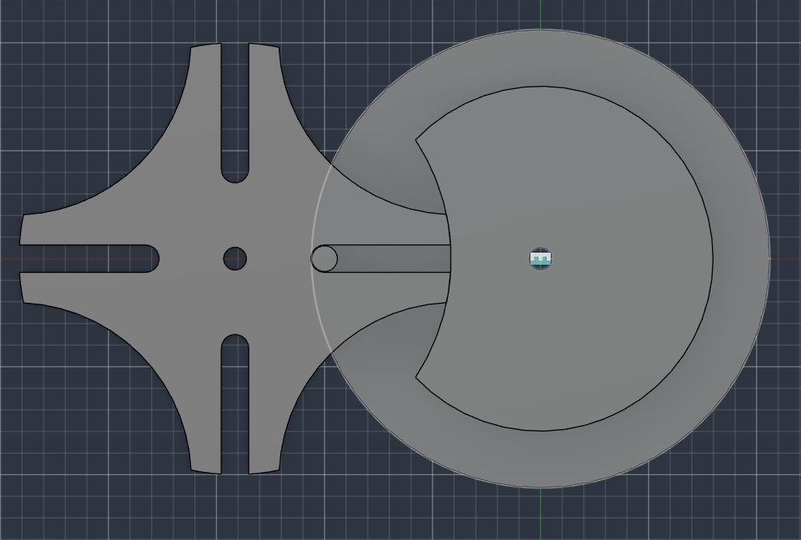
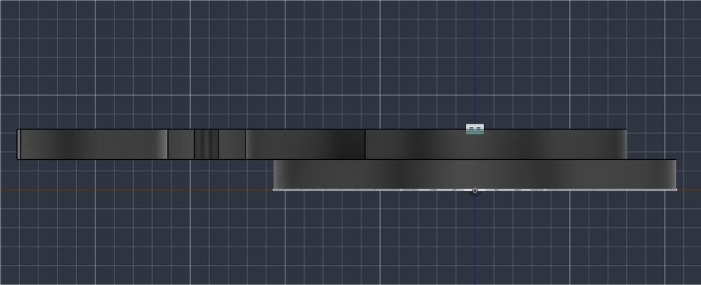

# 4-Slot Geneva Drive

A mechanical engineering project where I designed, calculated, 3D printed, and tested a four-slot Geneva drive.

The main version is hand-spun. I also modified the CAD files to fit a NEMA 17 stepper motor. I haven't built or tested the motorized version yet, but I'm confident it will work.

  
  

## What is a Geneva drive?

A Geneva drive converts continuous rotation into intermittent motion. The driver rotates continuously, while the Geneva wheel moves one position at a time and then locks in place.

I chose to build one because the mechanism is fairly simple to understand, yet even a small math or clearance error makes a big difference once the parts are printed and assembled.

## Design

I designed the mechanism in Fusion 360 and printed the parts in PETG on a Bambu Lab P1S. With four slots, the Geneva wheel rotates 90° per index.

| Parameter | Value |
|---|---|
| Slots (n) | 4 |
| Driven wheel radius (b) | 50.00 mm |
| Drive crank radius (a) | 50.00 mm |
| Center distance (C) | 70.71 mm |
| Pin diameter | 6.00 mm |
| Slot width | 6.35 mm |
| Design clearance (PETG) | 0.35 mm |
| Plate thickness | 8.00 mm |
| Locking wall diameter (as tuned) | 80.50 mm |

The full calculations are in [`Geneva_Drive_Calculator_1.xlsx`](Geneva_Drive_Calculator_1.xlsx).

## Working through the geometry

My first set of dimensions failed. The crank radius and wheel geometry didn't let the pin reach the slots correctly. Going back through the geometry, I found that a four-slot design requires the crank radius to equal the driven wheel radius.

I rebuilt the dimensions from the four-slot Geneva geometry and checked them against a published Geneva wheel design from FreeCAD, which gave me a much better starting point.

## The locking mechanism

The locking mechanism was the most tedious part.

My first design used a recessed area on the driver wheel to lock the Geneva wheel between rotations. It looked right in one position, but once printed and turned, the two parts interfered at the points of rotation. As far as I could tell, I had shaped the locking surface around the wrong center.

I went back to the standard Geneva geometry and redesigned the driver with a raised locking section and an opening for the Geneva wheel to pass through. I calculated the opening from the intersection of two circles instead of estimating the shape by eye.

The new print worked much better, though there was still some grinding during the locking part of the motion. I traced it to the clearance around the locking wall, reduced the wall diameter by 0.5 mm, and reprinted. After that, the mechanism moved smoothly by hand.

## Physical testing

I tested the final version by hand and checked that:

- the Geneva wheel moves through all four positions
- the wheel locks between each position
- the pin enters and leaves the slots without getting stuck
- the mechanism completes repeated rotations
- the printed parts have enough clearance to move without excessive friction

The final version completes the four-position indexing cycle by hand.

## NEMA 17 version

I also made a version of the CAD design for a NEMA 17 stepper motor. The repository includes modified Fusion 360 assemblies, STEP and STL files, and a preliminary Arduino `.ino` sketch.

This version is not finished or physically tested; the hand-spun drive is still the main mechanism. I included the motor files because I plan to automate the mechanism and see how the printed Geneva drive holds up under continuous motor-driven rotation.

## Files

| File | Description |
|---|---|
| `GenevaCADfile.f3z` | Original Fusion 360 assembly |
| `GenevaCADfiles.step` | STEP version of the Geneva drive |
| `GenevaCADfiles.stl` | STL files for 3D printing |
| `Geneva_Drive_Calculator_1.xlsx` | Design calculations and dimensions |
| `Geneva_Sideview.png` | Side view of the design |
| `Geneva_Topview.png` | Top view of the design |
| `Nema - 17 - Geneva Drive'.stl` | Modified STL for NEMA 17 integration |
| `Nema 17 - Geneva Drive.step` | Modified STEP model |
| `Nema 17 - Geneva Drive.f3z` | Modified Fusion 360 assembly |
| `nema17_geneva_driver.ino` | Preliminary Arduino motor-control code |
| `LICENSE` | Project license |

## Tools and materials

- Fusion 360
- Bambu Lab P1S with PETG
- Excel for the design calculations
- FreeCAD for checking the Geneva geometry
- Arduino for future motor integration

## What I learned

Getting the math right is only part of designing a mechanical system. My first design looked reasonable on paper, but the printed parts showed problems the model didn't. I had to go back to the geometry, work out why the parts were interfering, change the design, and print and test it again.

The locking mechanism taught me the most: the first version looked like it should work, and physical testing showed it didn't. That cycle of designing, printing, testing, finding a problem, and fixing it is what I wanted this project to document.

## Future plans

- Finish the NEMA 17 version and test the drive under motor power.
- Experiment with different print clearances and materials to see how they affect friction, movement, and locking.

## License

This project is open source. See [`LICENSE`](LICENSE) for the terms.
